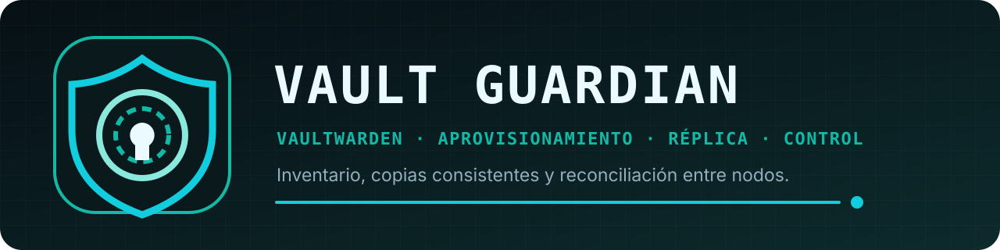
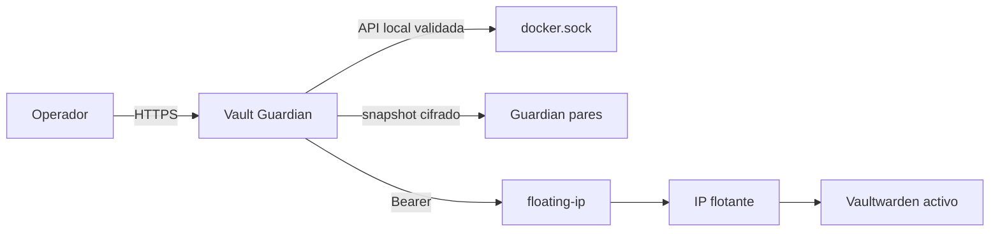

  

  
  
  
  

<strong>Inventario, aprovisionamiento y réplica de Vaultwarden desde un único portal.</strong>

Vault Guardian 1.0.19 administra, aprovisiona, reconcilia y replica varias instancias
Vaultwarden entre varios servidores. La autoridad de cada IP flotante permanece en
Keepalived; Guardian sólo toma como origen al único portador confirmado. `1.0.19`
es la versión estable actual de este repositorio.

Este repositorio compartido no contiene nombres, IP, rutas, credenciales ni inventarios de
una instalación concreta. El primer arranque comienza sin nodos ni Vaultwarden precargados.

**[Instalación](docs/installation.md)** ·
**[Arquitectura](docs/architecture.md)** ·
**[API](docs/api.md)** ·
**[Operación](docs/operations.md)** ·
**[Seguridad](docs/security.md)**

## Funciones conservadas en 1.0.19

- Portal completo con primera cuenta elegida por el usuario, sesiones, CSRF, usuarios y
  segundo factor TOTP.
- Descubrimiento de contenedores oficiales Vaultwarden y alta automática fijada por digest.
- Preflight de todos los destinos antes de crear contenedores o reclamar una IP.
- Snapshot SQLite consistente, transporte cifrado, backups, linaje y antirreplay.
- Reconciliación de nodos añadidos después y rollback automático. El portador único
  confirmado sustituye divergencias pasivas después de conservar un backup local.
- API `/api/v1` con aplicaciones identificadas y un Bearer independiente y revocable para
  cada consumidor.
- Imágenes para servidores Docker Linux `amd64` y `arm64`, publicadas en GHCR por versión.

## Frontera Docker

Vault Guardian se instala como un único contenedor. Ese contenedor monta el socket Docker
local y limita las operaciones de la aplicación a:

- contenedores Vaultwarden oficiales;
- imágenes fijadas por digest;
- nombres, puertos, labels, red y rutas de nuevas réplicas;
- correspondencia validada entre cada `/data` y la raíz host montada en `/instances`;
- `inspect`, `start`, `stop` y aprovisionamiento según el tipo de recurso.

El socket concede control equivalente al del daemon Docker: limita el acceso al panel y al
host, y no expongas el socket por TCP. El contenedor conserva la raíz de sólo lectura,
capabilities eliminadas y `no-new-privileges`.

## ¿La plantilla construye la imagen?

No. Una plantilla Unraid describe cómo ejecutar una imagen, pero no compila el proyecto.
Las plantillas públicas apuntan a `ghcr.io/ezr43l/vault-guardian-s:stable`
(versión actual `1.0.19`). Para desarrollo, `docker compose build` o
`./build-image.sh` construyen la fuente localmente. Nosotros subimos las imágenes
terminadas a GHCR y el código a GitHub; GitHub no construye ni prueba nada.

## Instalación rápida con Compose

1. Copia `.env.example` a `.env`.
2. Crea `local-data/state`, accesible por `root` y con modo `0700`.
3. Configura `VG_DATA_PATH` con la raíz host que contiene los bind mounts `/data`
   de Vaultwarden. Docker la monta en `/instances`; no puede cambiarse desde el portal.
4. Revisa el bind address; la política HTTPS se elige al crear la primera cuenta.
5. Ejecuta `docker compose config`, `docker compose pull` y `docker compose up -d`.
6. Abre el portal, crea la primera cuenta y completa grupo, Keepalived e inventario desde
   la aplicación. El secreto local se genera dentro de `/state`.

Para probar el código local, sustituye `VG_IMAGE` por `vault-guardian:1.0.19` y ejecuta
`docker compose build` antes de arrancar. La guía reproducible está en
[docs/installation.md](docs/installation.md). No cambies a
`active` hasta completar [docs/release-checklist.md](docs/release-checklist.md).

## Instalación en Unraid

1. Crea el único directorio persistente `/mnt/user/appdata/vault-guardian`, con modo `0700`
   y propietario `root`.
2. Instala únicamente `my-Vault-Guardian.xml`; sólo pide puerto, estado, raíz de datos
   Vaultwarden y socket Docker.
3. Elige HTTPS o HTTP aislado y completa la primera cuenta, el grupo y el token de Keepalived desde el portal.
4. Verifica que existe exactamente un contenedor `Vault-Guardian` y un único montaje de
   `/var/run/docker.sock`.

## Credenciales distintas

- `VG_REPLICATION_TOKEN[_FILE]`: autentica pares, cifra paquetes y deriva claves de sesión.
- `VG_FLOATING_API_TOKEN[_FILE]`: autoriza consultas y reclamaciones en floating-ip.
- `VG_API_TOKEN[_FILE]`: compatibilidad de migración para el antiguo token único; el portal
  lo incorpora como «Integración anterior sin identificar» hasta que el usuario lo renombre.

En una instalación nueva, el secreto de replicación se genera en el volumen persistente y
el token de Keepalived y las aplicaciones consumidoras de la API se administran desde el
portal autenticado. Cada aplicación dispone de una credencial propia, visible y revocable. La
duración de sesión, los límites del historial, el acceso HTTP/HTTPS y una CA privada opcional
también se cambian dentro de la aplicación. Los parámetros `*_FILE` se conservan sólo como
compatibilidad de migración; cuando el usuario guarda un valor en el portal, éste pasa a ser
la configuración efectiva.

## Documentación

- [Instalación](docs/installation.md)
- [Guía de plantillas](docs/template-guide.md)
- [Arquitectura](docs/architecture.md)
- [Seguridad](docs/security.md)
- [Operación y recuperación](docs/operations.md)
- [Contrato de replicación](docs/replication-contract.md)
- [API](docs/api.md)
- [Contrato de producto](docs/product-contract.md)
- [Checklist de release](docs/release-checklist.md)

Licencia: [Apache-2.0](LICENSE). El desarrollo continúa en el repositorio privado;
`Ezr43l/vault-guardian-s` recibe el código y los archivos públicos preparados.

## Soporte

El soporte se presta exclusivamente en la comunidad de Discord de Unraides:

**[Entrar en Unraides](https://discord.gg/8MAT6ZGJTW)**

No se atienden solicitudes de soporte en GitHub. Al pedir ayuda, indica la
versión de la aplicación y el error, sin compartir contraseñas ni tokens.
