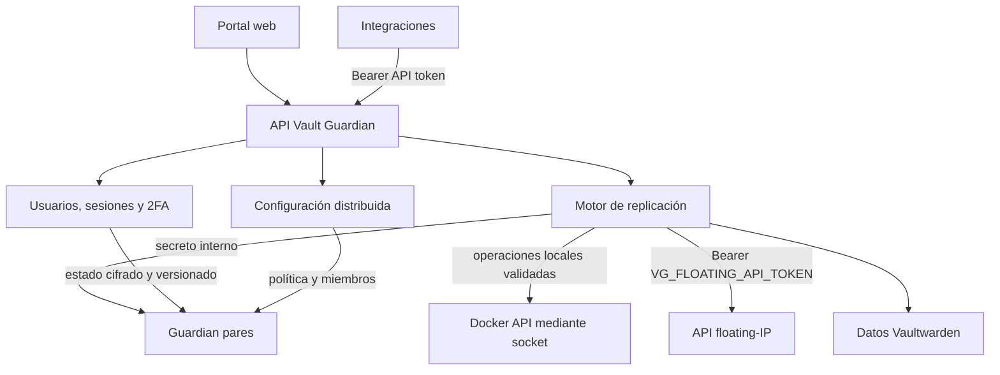
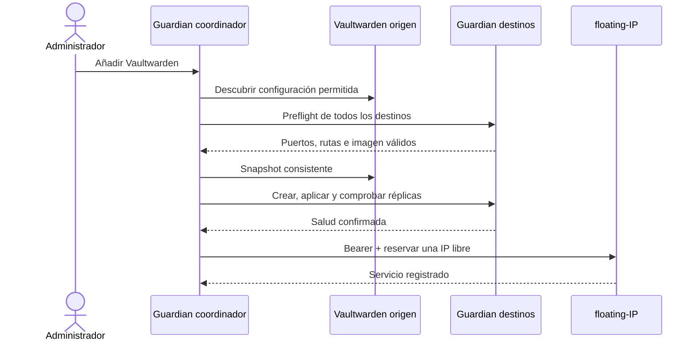
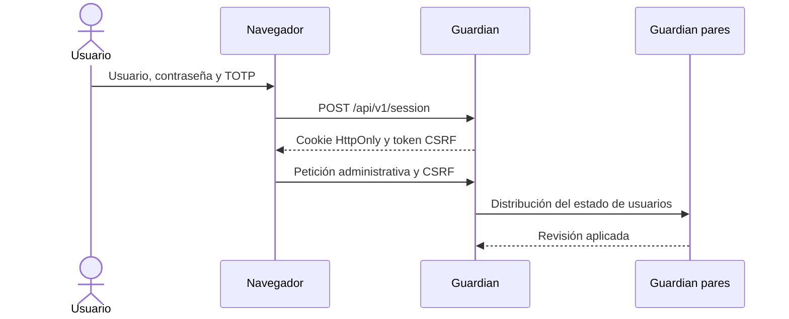

# Arquitectura

Vault Guardian coordina N instancias de Vaultwarden en N servidores. Cada instancia es un
servicio lógico independiente y tiene su propio contenedor, volumen, salud y dirección
flotante.

## Componentes

- **Portal:** interfaz administrativa autenticada.
- **API:** contrato estable para el portal y otros contenedores.
- **Seguridad:** cuentas locales, sesiones, TOTP y códigos de recuperación.
- **Configuración:** miembros, política e instancias compartidas.
- **Replicación:** snapshots, cifrado, entrega, backups y restauración.
- **Integración Docker:** forma parte del único contenedor Vault Guardian y valida el
  contrato de alto nivel antes de descubrir o modificar contenedores autorizados.
- **floating-IP:** fuente de verdad del portador y reserva de direcciones.

## Autoridades

| Decisión | Autoridad |
|---|---|
| Portador de una VIP | floating-IP / Keepalived |
| Contenido canónico de una instancia | Vaultwarden del portador confirmado |
| Miembros, política e instancias | configuración distribuida de Guardian |
| Acceso humano | usuarios de Vault Guardian |
| Acceso de integraciones | Un Bearer identificado y revocable por aplicación |
| Comunicación entre Guardian | `VG_REPLICATION_TOKEN` |
| Acceso de Guardian a floating-IP | `VG_FLOATING_API_TOKEN` |
| Acceso al daemon Docker local | socket Unix montado en el único contenedor |

Guardian no elige un líder alternativo ni admite escrituras multi-activas.

## Alta automática

La reserva de IP es el último paso. La transacción persistente permite reintentar una
interrupción sin duplicar contenedores ni direcciones.

## Replicación continua

Todas las consultas y mutaciones contra floating-IP llevan el token Bearer configurado.

1. Consulta el portador de la VIP mediante la API autenticada.
2. Sólo el Guardian del portador crea el snapshot.
3. Cifra el paquete y lo envía a los pares.
4. Cada receptor vuelve a consultar la VIP.
5. Un receptor que sea portador o no pueda confirmar el estado rechaza la aplicación.
6. El pasivo guarda un backup, detiene sólo su contenedor, sustituye datos y lo arranca.
7. Las huellas y el resultado quedan registrados por destino.

`observe` sólo lee; `dry-run` prepara sin entregar; `active` permite replicar.

## Identidad y acceso

El fichero `/state/auth.json` contiene hashes de contraseña, secretos TOTP cifrados,
hashes de códigos de recuperación y una revisión monotónica. No contiene contraseñas,
TOTP en claro ni códigos de recuperación recuperables.

## Persistencia

| Ruta | Contenido |
|---|---|
| `/state/instances.json` | instancias declaradas |
| `/state/settings.json` | identidad y política operativa |
| `/state/auth.json` | usuarios y segundo factor |
| `/state/backups/<id>` | backups de cada instancia |
| `/state/history.jsonl` | historial operativo acotado y rotado atómicamente |
| `/state` | huellas y transacciones |

`/state` debe persistir y tratarse como información sensible.

## Límites

- Sólo se clona el contrato admitido de la imagen oficial de Vaultwarden.
- La integración Docker sólo crea réplicas y admite fuentes `/data` bajo la raíz host
  montada en `/instances`; no crea contenedores auxiliares.
- No se aceptan privilegios, red host, dispositivos, montajes adicionales ni comandos
  personalizados en el alta automática.
- No se resuelven automáticamente dos linajes divergentes.
- Un único servidor es funcional, pero no ofrece redundancia.
- El historial se limita por bytes y entradas, se mantiene con modo `0600` y se lee desde
  el final sin cargar ni recorrer más que el presupuesto configurado de retención.
- La pérdida simultánea del estado de usuarios y de las credenciales iniciales requiere
  restaurar `/state` o efectuar una recuperación administrativa controlada.
