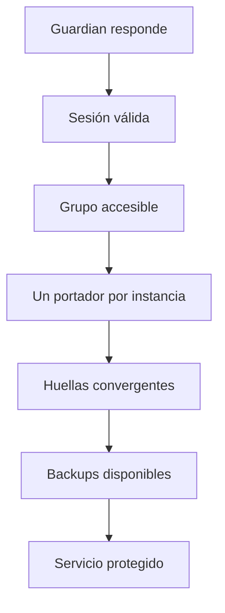

# Operación segura

Esta guía cubre el funcionamiento diario, acceso, mantenimiento y recuperación. La
instalación inicial se describe en [template-guide.md](template-guide.md).

## Comprobaciones habituales

Comprobar, por este orden, salud y versión, inicio de sesión, miembros accesibles, portador
único, salud de Vaultwarden, huellas, última sincronización y backups. Un proceso HTTP sano
no implica que las instancias estén protegidas.

## Acceso al portal

Cuando `/state/auth.json` no contiene usuarios, el portal permite crear la primera cuenta
con las credenciales elegidas por el operador. Esta operación sólo se admite una vez y no
usa valores de la plantilla. Después, todas las cuentas se gestionan en **Seguridad**.

- Cada usuario tiene acceso administrativo completo en 1.0.20.
- Deshabilitar o cambiar la contraseña invalida sus sesiones.
- No se puede eliminar ni deshabilitar el último usuario.
- La cuenta de la sesión actual modifica sus credenciales desde **Mi cuenta**.
- Activar o desactivar 2FA invalida sesiones anteriores.
- Los códigos de recuperación son de un solo uso.

Si un par está inaccesible durante un cambio de usuarios, la interfaz muestra el fallo de
distribución. No debe darse por convergente hasta recuperar el par y confirmar la misma
revisión.

## Alta y baja de usuarios

Para añadir una cuenta:

1. Abrir **Seguridad → Usuarios**.
2. Introducir usuario, nombre visible y una contraseña de al menos 12 caracteres.
3. Guardar y comprobar el resultado de distribución.
4. Pedir al usuario que inicie sesión y active 2FA.

Para retirar acceso, deshabilitar primero la cuenta. Eliminarla sólo después de verificar
que queda otra cuenta habilitada.

## 2FA y recuperación

TOTP es compatible con aplicaciones autenticadoras estándar. El alta presenta QR y clave
manual; la activación exige un código válido. Guardian genera diez códigos de recuperación
y sólo almacena sus hashes.

Ante pérdida del autenticador:

1. Iniciar sesión con un código de recuperación.
2. Entrar en **Mi cuenta**.
3. Desactivar 2FA o regenerar códigos con otro factor válido.
4. Configurar de nuevo el autenticador si procede.

Si no queda autenticador ni código de recuperación, otra cuenta puede restablecer la
contraseña, pero no omitir el segundo factor. La recuperación total requiere restaurar un
`auth.json` válido o intervenir sobre `/state` con Guardian detenido y procedimiento
auditado. No borrar el fichero en producción.

## Secretos

| Secreto | Uso | Distribución |
|---|---|---|
| Contraseña de usuario | Portal | Individual |
| Bearer por aplicación | Integraciones API | Sólo el consumidor identificado |
| `VG_REPLICATION_TOKEN` | Pares, cifrado y sesiones | Igual en todos los Guardian |
| `VG_FLOATING_API_TOKEN` | API de IP flotante | Token propio en cada Guardian |

No se registran ni se incluyen en documentación. `/state`, backups y paquetes de réplica
contienen información sensible.

## Mantenimiento de un nodo

1. Drenar el nodo desde floating-IP.
2. Esperar a que deje de portar las VIP.
3. Confirmar que el nuevo portador está sano.
4. Actualizar o reiniciar Guardian.
5. Verificar versión, login, grupo y huellas.
6. Reincorporar el nodo.
7. Sincronizar si quedó obsoleto.

No se recrea Keepalived sin retirar antes sus VIP.

## Salud para floating-IP

- `/api/version` comprueba que el backend HTTP responde.
- `/api/v1/instances/{id}/readiness` informa si el nodo puede servir una instancia.
- Readiness devuelve 200 si es apto y 503 con motivos si debe excluirse.
- Debe combinarse con la salud de Vaultwarden; no sustituye la autoridad de Keepalived.

Las rutas operativas requieren sesión o token API. Salud, versión y la comprobación
de readiness de una instancia permanecen públicas y no devuelven secretos.

## Autenticación de la API de IP flotante

Cada Guardian necesita `VG_FLOATING_API_TOKEN` con permisos `status:read` y
`claims:write`. El token se envía como `Authorization: Bearer`; no se guarda en
`/state/settings.json`.

Si el panel no puede confirmar portadores o una alta no puede reservar la VIP:

1. comprobar en **Grupo > Conexión con Keepalived** que el token figura configurado;
2. consultar `/api/direcciones` con ese Bearer desde el mismo servidor;
3. distinguir `401` —token ausente, inválido o revocado— de `403` —permisos insuficientes—;
4. sustituir el token desde el portal autenticado, sin recrear el contenedor;
5. confirmar en **Grupo > Requisitos** que el token figura como completado.

No registrar el valor en logs, capturas, historial ni documentación.

## Backups y retención

La política conserva cinco backups por instancia por defecto y admite entre 1 y 1000.
Se almacenan en `/state/backups/<id>`.

Para restaurar:

1. Confirmar el portador actual.
2. Elegir un nodo pasivo; nunca restaurar sobre el portador.
3. Revisar `GET /api/v1/instances/{id}/backups`.
4. Ejecutar la restauración con `confirm: true`.
5. Guardian crea un backup previo, detiene sólo el contenedor declarado y garantiza el
   intento de arranque.
6. Verificar Vaultwarden, VIP, huella y backups.
7. Sincronizar desde el portador si el nodo debe volver al estado canónico.

No copiar manualmente una SQLite viva ni modificar paquetes `.vgb`.

## Historial y rotación

`/state/history.jsonl` conserva operaciones, no secretos. Por defecto se limita a 16 MiB y
5000 entradas. Ambos valores se editan en **Ajustes de la aplicación** dentro de sus límites
de 1–256 MiB y 500–100000 entradas. Cuando se alcanza cualquiera de los dos límites, Guardian escribe en el mismo
directorio un fichero privado `0600`, conserva primero los registros válidos más recientes y
lo sustituye de forma atómica. La lectura de la API recorre el fichero desde el final y limita
tanto la memoria como los bytes examinados al presupuesto configurado de retención.

No reemplaces el historial por un enlace, FIFO o dispositivo: la operación falla de forma
segura. Una última línea incompleta se recupera durante la siguiente rotación; las líneas
dañadas se omiten sin desplazar registros recientes válidos. Incluye `history.jsonl` en la
copia de `/state`, pero no en el snapshot público del código.

## Métricas

`GET /metrics` y `GET /api/v1/metrics` requieren sesión o token API. Conviene alertar
cuando la autoridad de IP sea desconocida, el portador no responda, una sincronización
falle, falte un backup o las huellas diverjan.

## Migración y baseline

1. Actualizar todos los Guardian en `observe`.
2. Calcular baseline con `confirm: false` en cada nodo.
3. Comparar las huellas.
4. Si coinciden, confirmar con la huella esperada.
5. Verificar readiness y estado del grupo.
6. Activar de forma controlada.

Baseline no aplica datos ni detiene Vaultwarden.

## Despliegue de Guardian

El despliegue recrea el único contenedor Vault Guardian. Conserva `/state` y no modifica
los contenedores Vaultwarden durante la actualización de Guardian.
El contenedor anterior puede mantenerse como rollback durante la comprobación del nodo,
pero se elimina cuando el grupo queda validado.

Verificaciones mínimas:

- versión `1.0.20`;
- login y 2FA;
- mismo número de usuarios y revisión en los miembros;
- API Bearer, si está configurada;
- grupo accesible e instancias sin cambios;
- icono instalado en la caché de Unraid;
- ausencia de contenedores de rollback al finalizar.
- un único contenedor Vault Guardian, un único montaje de `docker.sock` y la raíz
  Vaultwarden montada en `/instances`;
- el contenedor funciona como `0:0`, con rootfs de sólo lectura, y puede escribir `/state`.
