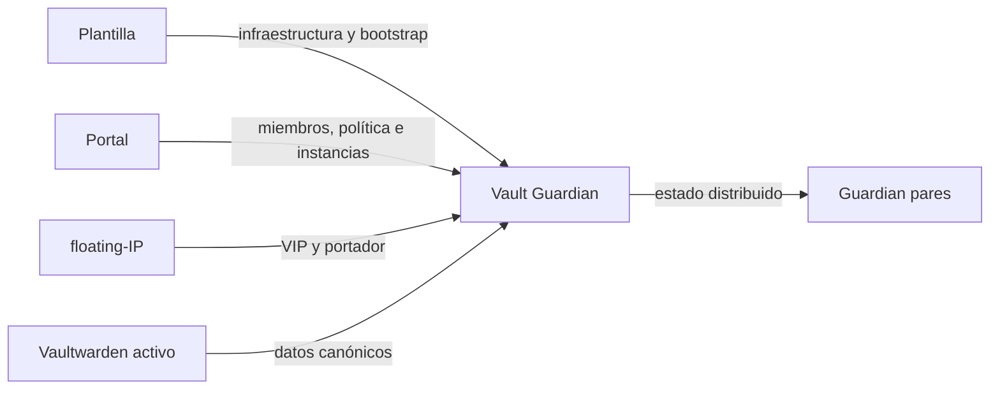

# Contrato de producto de Vault Guardian

Estado: activo para 1.0.17.

## Propósito

Vault Guardian administra N servicios Vaultwarden en N servidores y muestra, para cada
uno, disponibilidad, portador, sincronía y capacidad de relevo. No sustituye Vaultwarden
ni floating-IP.

La pantalla de resumen responde:

1. estado agregado del grupo;
2. portador de cada instancia;
3. salud y sincronía de los destinos;
4. última operación confirmada;
5. bloqueos que requieren intervención.

Un proceso HTTP activo no equivale a un servicio protegido.

## Usuarios

- **Administrador humano:** entra con cuenta propia y 2FA opcional.
- **Integración:** consume la API mediante token Bearer.
- **Guardian par:** usa el secreto interno para configuración y datos.

En 1.0.17 todos los usuarios del portal tienen permisos administrativos. Las credenciales
de Vaultwarden no autentican Vault Guardian.

## Navegación

| Sección | Contenido |
|---|---|
| **Resumen** | Veredicto del grupo, miembros e instancias |
| **Grupo** | Servidores y configuración compartida |
| **Vaultwarden** | Alta, detalle y acciones por instancia |
| **Operación** | Política, sincronización e historial |
| **Seguridad** | Mi cuenta, usuarios y 2FA |
| **Referencia** | Campos, estados y criterios operativos |

El login es una pantalla independiente. Tras autenticar, la cuenta y la salida permanecen
en la cabecera. La navegación conserva posición y jerarquía comunes con Keepalived y NPM
Guardian.

## Estados canónicos

| Estado | Significado | Escrituras |
|---|---|---|
| `unconfigured` | Falta configuración imprescindible. | Bloqueadas |
| `observing` | Lee y valida; no replica. | Bloqueadas |
| `ready` | Configuración válida; protección no activa. | Sólo validaciones |
| `protected` | Portador fiable y destinos confirmados. | Permitidas por política |
| `degraded` | Servicio disponible con réplica o nodo incompleto. | Sólo acciones seguras |
| `unknown` | No responde una autoridad necesaria. | Bloqueadas |
| `stale` | Estado local anterior al canónico. | No puede ser origen |
| `conflict` | Existen linajes divergentes. | Bloqueadas |
| `blocked` | Una condición de seguridad impide operar. | Bloqueadas |

El modo `active` es una capacidad operativa, no un estado de salud.

## Estado protegido

Una instancia sólo es `protected` cuando:

- floating-IP responde y declara un único portador;
- Vaultwarden responde donde corresponde;
- el portador no está obsoleto ni en conflicto;
- todos los nodos requeridos responden;
- cada destino confirmó la última operación;
- se conocen huella y fecha de confirmación.

Un envío iniciado o aceptado no equivale a sincronización confirmada.

## Fuentes de verdad

- **Plantilla:** sólo puerto, `/state` y socket Docker; la política HTTP inicial y las
  credenciales, el grupo, Keepalived y las instancias se completan en el portal.
- **Portal:** miembros, política, instancias, usuarios y 2FA.
- **floating-IP:** direcciones y portadores.
- **Vaultwarden:** contenido de las bóvedas.
- **API:** estado operativo e integración declarativa.

No se duplican miembros, política o instancias en variables de la plantilla.

## Acciones

- **Validar:** no escribe datos.
- **Añadir Vaultwarden:** valida destinos, crea réplicas, copia estado, comprueba salud y
  reserva una IP al final.
- **Reconciliar:** crea sólo réplicas ausentes en un servidor añadido.
- **Sincronizar:** actúa sólo sobre la instancia seleccionada y resuelve el portador.
- **Restaurar:** sólo en un pasivo confirmado y con backup previo.
- **Resolver conflicto:** operación excepcional, separada de la sincronización normal.
- **Gestionar usuarios:** distribuye una revisión común del estado de identidades.

Cada acción muestra alcance, inicio, ejecutor, destinos y resultado final. Si está
bloqueada, muestra el motivo.

## Sistema visual

- Paleta, tipografía, densidad, controles y estados compartidos con Keepalived y NPM
  Guardian.
- Cabecera con producto, nodo, estado, cuenta y salida.
- Navegación principal estable.
- Tarjetas por instancia y detalle técnico secundario.
- Diálogos y notificaciones propios; sin confirmaciones del navegador.
- Texto directo, preciso y sin mensajes promocionales.
- Color acompañado por etiqueta o texto.
- Sin desplazamiento horizontal en móvil.
- Icono PNG servido por la app y validado en ambas cachés de Unraid.

## Generalización

La imagen, plantilla, interfaz, API y ejemplos no contienen nombres, IPs, rutas,
credenciales ni topologías de una instalación real. Los ejemplos usan Vaultwarden 1,
Vaultwarden 2 y nodos neutrales. El número de servidores e instancias no está fijado.
