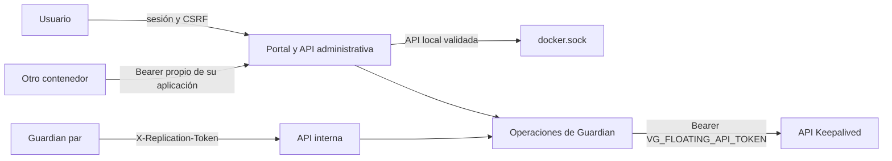

# Seguridad, usuarios y 2FA

## Modelo

Vault Guardian separa cinco canales de autenticación:

Las credenciales no son intercambiables. El portal no utiliza el token de integraciones,
una integración no recibe el secreto interno y el token de Keepalived sólo sale de
Guardian hacia la API de IP flotante. El token Docker sólo circula por una red privada
entre el portal y el controlador; el portal nunca recibe el socket.

## Cuenta inicial

Cuando no hay usuarios, el portal cambia a **Crear primera cuenta**. El usuario elige un
nombre de 3 a 64 caracteres, un nombre visible opcional y una contraseña de 12 caracteres
como mínimo, que debe confirmar.

`POST /api/v1/auth/setup` es público únicamente mientras el almacén no contiene usuarios.
La creación se serializa, genera la revisión 1, intenta distribuirla a los Guardian
configurados y devuelve una sesión firmada. Cualquier intento posterior recibe
`AUTH_ALREADY_CONFIGURED`.

La operación exige un secreto de grupo porque éste firma sesiones y protege la
distribución del estado. En un grupo nuevo se genera localmente bajo
`/state/secrets/replication-token`; al añadir un nodo, el operador pega durante
el alta el código mostrado por un miembro ya autenticado. No existe usuario,
contraseña ni secreto compartido predeterminado en la imagen o la plantilla.

Si la cuenta se creó cuando aún no había pares, guardar después **Servidores del grupo**
actualiza la lista interna y distribuye el estado de identidad vigente sin incrementar su
revisión. Los conflictos o miembros inaccesibles se muestran en el resultado del panel.

## Almacén de identidades

`/state/auth.json` usa formato versionado y revisión monotónica. Guarda UUID, usuario,
nombre visible, estado, hash scrypt con sal, versión de sesión, secreto TOTP cifrado,
hashes HMAC de recuperación y fechas.

El fichero se escribe de forma atómica y con permiso `0600` cuando el sistema de archivos
lo permite. No contiene contraseñas, TOTP en claro ni códigos recuperables.

## Sesiones

Al autenticar, Guardian emite una cookie firmada con `HttpOnly`, `SameSite=Strict`,
`Path=/` y caducidad entre 5 y 480 minutos. Incluye identidad, versión de sesión,
caducidad, nonce y CSRF; no la contraseña.

Las escrituras con sesión requieren `X-CSRF-Token`. Cambiar contraseña, estado o 2FA
invalida las sesiones anteriores. La cookie lleva `Secure` salvo que se elija
HTTP aislado. La decisión se puede modificar después desde **Ajustes de la
aplicación**; una variable heredada sólo se utiliza mientras todavía no exista
una elección persistida por el portal.

## Contraseñas y limitación de intentos

Las contraseñas se derivan con scrypt y comparación constante. El usuario actual aporta su
contraseña vigente para cambiar la propia. Una cuenta autorizada puede restablecer la de
otra cuenta.

Se bloquean ocho fallos durante cinco minutos por origen y usuario. La respuesta no revela
si la cuenta existe.

## Segundo factor

Guardian implementa TOTP SHA-1 de seis dígitos y periodo de 30 segundos. El QR se genera
localmente. La activación exige confirmar un código válido y genera diez códigos de
recuperación de un solo uso.

Desactivar 2FA o regenerar códigos exige TOTP o recuperación válido. Los códigos nuevos
sólo se muestran una vez; Guardian almacena únicamente sus hashes.

## Usuarios

La versión 1.0.18 dispone de un único rol administrativo.

- Los nombres son únicos sin distinguir mayúsculas.
- Debe quedar al menos un usuario habilitado.
- La sesión actual no puede eliminarse ni deshabilitarse desde la lista.
- El usuario actual cambia sus credenciales desde **Mi cuenta**.
- Cada mutación incrementa la revisión distribuida.

Los roles diferenciados quedan fuera de 1.0.18.

## Distribución entre Guardian

Tras una mutación, el nodo envía el estado completo a
`PUT /api/v1/internal/security` con `X-Replication-Token`. El receptor valida formato,
rechaza revisiones anteriores, detecta contenido distinto con la misma revisión y sólo
aplica atómicamente una revisión posterior.

Los fallos por par se muestran al operador. No existe resolución automática de conflictos.
Cambiar el secreto interno invalida sesiones y hace ilegibles los TOTP cifrados con el
valor anterior; requiere una migración planificada.

## Acceso a Keepalived

`VG_FLOATING_API_TOKEN` es una credencial Bearer independiente. Guardian la adjunta a:

- `GET /api/direcciones`, con permiso `status:read`;
- `POST /api/claims`, con permiso `claims:write`;
- `DELETE /api/claims/{clave}`, con permiso `claims:write`.

En una instalación nueva el valor se introduce desde el portal autenticado y se
guarda en `/state/secrets/floating-api-token`. Una variable heredada sólo actúa
como valor inicial; al guardar desde el portal, el estado administrado tiene
precedencia. No forma parte de `settings.json`, no se
distribuye entre Guardian y no aparece en respuestas ni historial. Su ausencia
bloquea el estado fiable de las VIP y el alta automática antes de contactar con
Keepalived.

## Matriz de acceso

| Ruta | Sesión | Bearer API | Secreto interno |
|---|:---:|:---:|:---:|
| `/api/health`, `/api/version` | No | No | No |
| `/api/v1/auth/status` | No | No | No |
| `POST /api/v1/auth/setup` | Sólo sin usuarios | No | No |
| `/api/v1/instances/{id}/readiness` | No | No | No |
| `/api/v1/session` | Login | No | No |
| `GET /api/v1/status` | Sí | Sí | Sí; es la única lectura operativa autorizada entre nodos |
| Grupo, instancias, historial y métricas | Sí | Sí | No |
| Operaciones de Guardian | Sí + CSRF | Sí | No |
| Gestión y consulta de aplicaciones API | Sí + CSRF para cambios | No | No |
| Usuarios, perfil y 2FA | Sí + CSRF | No | No |
| `/api/v1/internal/*` | No | No | Sí |

El Bearer puede operar Guardian, pero no gestionar identidades, otras aplicaciones API ni
crear sesión web. Cada petición autenticada actualiza el último uso y la última ruta de la
aplicación propietaria del token.

## Control Docker

El único contenedor Vault Guardian monta `/var/run/docker.sock` y una raíz de datos
autorizada en `/instances`. Vuelve a validar las operaciones de inventario, imágenes,
archivos y aprovisionamiento, y sólo elimina réplicas con labels de una transacción
conocida; no ofrece un endpoint Docker de red ni comandos arbitrarios.

El socket concede autoridad equivalente a la del daemon Docker. El contenedor usa `0:0`,
rootfs de sólo lectura, capabilities eliminadas y `no-new-privileges`; aun así, el control
principal es restringir el acceso administrativo al host y al portal.

El proceso se ejecuta como `0:0` para conservar propietarios y acceder al socket Docker.
Antes de leer o escribir comprueba que el bind `/data` pertenece al Vaultwarden permitido,
es escribible y queda dentro de la raíz host montada en `/instances`; reconocer una imagen
oficial no amplía ese límite host.
Cada réplica nueva exige una ruta host completa dentro de esa raíz. Guardian acepta una
carpeta vacía o crea sólo la carpeta final; nunca sobrescribe datos existentes. El controlador serializa las
subidas y descargas de paquetes; el lector cuenta miembros y cabeceras TAR ocultas y
limita tamaño, expansión, metadatos y profundidad antes de extraer.

## Cabeceras y navegador

Las respuestas incluyen CSP restrictiva, protección contra framing, `nosniff`, política
de referencia y restricciones de capacidades. HTML y JSON no se cachean. No existe CORS
comodín. La interfaz usa diálogos propios y no `alert` o `confirm` del navegador.

## Backup y recuperación

Incluir `/state/auth.json` en el backup junto con el secreto interno. Guardar por separado
credenciales de al menos dos usuarios, códigos de recuperación, `VG_REPLICATION_TOKEN` y
`VG_FLOATING_API_TOKEN`.

La recuperación recomendada restaura un `/state` coherente. Eliminar `auth.json` para
volver a abrir la creación inicial elimina todas las identidades y factores existentes;
no es un procedimiento normal.

## Verificación

1. En estado vacío, crear la primera cuenta con credenciales elegidas por el usuario.
2. Confirmar que el portal exige login tras cerrar la sesión.
3. Verificar cookie HttpOnly/SameSite.
4. Confirmar que una escritura sin CSRF devuelve 403.
5. Activar TOTP y probar un nuevo login.
6. Consumir una recuperación y comprobar que no se reutiliza.
7. Añadir un usuario y comparar revisión en los nodos.
8. Confirmar Bearer para API y su rechazo en usuarios.
9. Comprobar salud y versión públicas.
10. Confirmar que el token de Keepalived consulta direcciones y que su ausencia devuelve 401.
