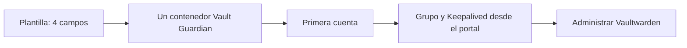

# Plantilla Unraid y primer arranque

La plantilla pública de Vault Guardian `1.0.19` descarga
`ghcr.io/ezr43l/vault-guardian-s:1.0.19` y crea exactamente un contenedor. No
compila la aplicación ni contiene nodos, direcciones, credenciales o datos del
autor.

## Los cuatro campos de Unraid

| Campo | Por qué pertenece a Docker |
|---|---|
| Puerto del panel | Unraid debe publicar el puerto `6062` del contenedor. |
| Datos de Vault Guardian | Es el único volumen persistente y sobrevive a las actualizaciones. |
| Raíz de datos Vaultwarden | Docker debe montarla antes de arrancar para que Guardian acceda a los bind `/data` sin crear contenedores auxiliares. |
| Socket de Docker | Permite descubrir y administrar sólo los Vaultwarden declarados. |

No se solicitan rutas internas, nombres de nodo, pares, límites, inventarios ni
ficheros de secretos. Los valores internos seguros forman parte de la imagen y
los datos operativos se configuran desde el portal.

## Orden de instalación

1. Crea `/mnt/user/appdata/vault-guardian` para `root`, con modo `0700`.
2. Instala `unraid/my-Vault-Guardian.xml` y revisa sus cuatro conexiones Docker.
3. Abre el portal, elige HTTPS o HTTP aislado y crea la primera cuenta. El secreto local del grupo se genera
   automáticamente dentro del volumen.
4. En **Grupo**, define el nombre, la IP y el directorio host para réplicas.
5. En **Conexión con Keepalived**, introduce el token generado por el Keepalived
   de ese servidor.
6. Añade las instancias Vaultwarden y mantén el modo `observe` hasta completar
   las comprobaciones.

Para añadir otro Guardian, pulsa **Mostrar código del grupo** en un nodo ya
configurado y pégalo en **Código de un grupo existente** al crear la primera
cuenta del nodo nuevo. El código no se escribe en la plantilla.

El socket Docker concede autoridad equivalente a la del daemon. No lo publiques
por TCP y limita el acceso al portal mediante HTTPS, VPN o firewall. Si el primer
alta se realiza por HTTP, activa esa opción sólo en una red de administración y
migra después a HTTPS.
